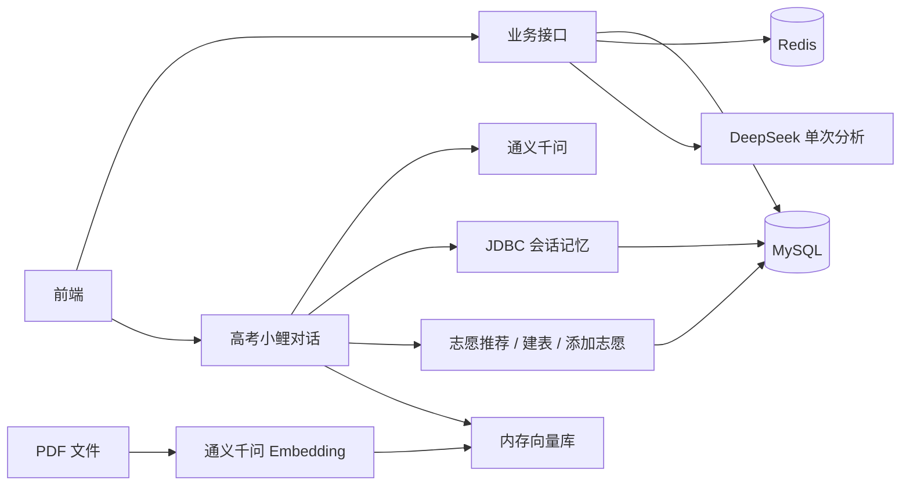

# 跃鲤志选 · 服务端

跃鲤志选是一个面向高考志愿填报场景的后端项目，提供院校与专业查询、历年分数线查询、志愿表管理、收藏评论和 AI 咨询功能。项目基于 Java 17、Spring Boot 和 Spring AI，结合 MySQL、Redis 与 PDF 知识库，为前端提供业务接口和流式对话服务。

本仓库包含服务端代码；前端、完整的业务数据库结构与院校数据需要单独准备。

## 主要功能

| 模块 | 功能 |
| --- | --- |
| 院校查询 | 分页筛选、名称搜索与搜索提示、院校详情、热门院校、强基计划院校、历年分数线 |
| 专业查询 | 学科门类与专业类别、专业详情、开设院校、院校专业分数线 |
| 志愿辅助 | 按成绩、位次和选科等条件筛选志愿，提供冲、稳、保分类及录取预测 |
| 志愿表 | 创建、重命名、清空与删除志愿表，添加和删除志愿，AI 分析志愿表 |
| 用户与互动 | 注册登录、个人资料、院校与专业收藏、评论、密码修改和账号注销 |
| AI 咨询 | “高考小鲤”流式对话、会话记录、上下文记忆、志愿推荐与志愿表工具调用 |
| 知识库 | 启动时读取指定目录的 PDF，构建内存向量库，为 AI 对话提供检索上下文 |
| 图片上传 | 通过阿里云 OSS 保存头像等图片 |

## 技术栈

以下版本来自当前仓库的 Maven 配置。

| 技术 | 版本 / 用途 |
| --- | --- |
| Java | 17 |
| Spring Boot | 3.4.6，应用框架 |
| Spring AI | 1.0.5，模型调用、对话记忆、工具调用与 RAG |
| MyBatis | Spring Boot Starter 3.0.4，数据访问 |
| MySQL | 业务数据与对话记忆；JDBC 驱动 8.2.0 |
| Redis | 业务缓存、刷新会话、令牌黑名单与验证码 |
| PageHelper | 2.1.0，分页查询 |
| JJWT / BCrypt | 访问令牌签名与密码散列 |
| Knife4j | 4.5.0，接口文档 |
| 阿里云 OSS SDK | 3.17.4，图片存储 |
| Maven | 多模块构建与依赖管理 |

## 项目结构

```text
.
├── pom.xml                         # 父工程与统一依赖版本
├── college-common/                 # 常量、枚举、异常和配置属性
├── college-pojo/                   # Entity、DTO、VO 与统一响应对象
├── college-utils/                  # JWT、OSS、敏感词过滤等工具
└── college-server/                 # Spring Boot 启动模块
    └── src/main/
        ├── java/a311/college/
        │   ├── CollegeServerApplication.java
        │   ├── controller/        # HTTP 接口
        │   ├── service/           # 业务服务
        │   ├── mapper/            # MyBatis Mapper 接口
        │   ├── auth/              # JWT 与 Redis 会话管理
        │   ├── agent/             # AI 调用与会话处理
        │   ├── tool/              # AI 可调用的业务工具
        │   ├── config/            # Web、模型、文档等配置
        │   └── database/          # 独立的数据导入工具
        └── resources/
            ├── application.yml    # 公共配置，默认启用 dev
            ├── a311/college/mapper/# Mapper XML
            ├── prompt/            # 单次查询与多轮对话提示词
            ├── sensitive/         # 敏感词库
            └── sql/agent.sql      # Spring AI 对话记忆表
```

## AI 如何分工

| 能力 | 调用入口 | 模型与配置 |
| --- | --- | --- |
| 院校介绍、专业介绍、志愿表分析 | `simpleChatClient` | DeepSeek，读取 `college.ai.deepseek.*`；单次请求，不挂载对话记忆与业务工具 |
| “高考小鲤”对话 | `agentChatClient` | 通义千问，读取 `college.ai.qwen.*`；支持流式输出、会话记忆、工具调用与知识库检索 |
| PDF 与查询文本向量化 | `OpenAiEmbeddingModel` | 通义千问 Embedding，读取 `spring.ai.openai.*`；当前配置为 `qwen3.7-text-embedding-flash`，1024 维 |

两个对话模型都通过 OpenAI 兼容协议接入，具体构建逻辑见 [SpringAIConfiguration.java](college-server/src/main/java/a311/college/config/SpringAIConfiguration.java)。



对话记忆由 MySQL 持久化，窗口最多保留 50 条消息。知识库使用 `SimpleVectorStore`，检索最多取 2 个片段，相似度阈值为 0.3；向量数据只保存在内存中，重启后重新导入。

## 本地运行

### 1. 准备环境和数据

- 安装 JDK 17、Maven，并准备可连接的 MySQL 和 Redis。
- 准备 DeepSeek 与通义千问 API Key；通义千问 Key 同时用于对话与 Embedding。
- 使用图片上传功能时，准备 OSS Bucket 和访问凭据。
- 导入与当前 Mapper 匹配的业务数据库结构和数据。

**数据库准备是必要步骤。** 仓库中的 [agent.sql](college-server/src/main/resources/sql/agent.sql) 仅负责 `SPRING_AI_CHAT_MEMORY` 表，应用配置会在启动时执行该脚本；它不包含用户、院校、专业、志愿表以及业务会话记录等表。完整业务 SQL 和院校数据暂未随仓库提供，需要向项目维护者获取。当前院校查询还依赖 `tb_school.ruanke_rank` 字段，使用旧数据库时需要核对表结构。

克隆项目后，在仓库根目录执行后续构建命令：

```bash
git clone https://github.com/Zxlove720/YueLiZhiXuan-Server.git
cd YueLiZhiXuan-Server
```

### 2. 创建本地配置

在 `college-server/src/main/resources/` 下新建 `application-dev.yml`。该文件已加入 Git 忽略规则，请使用自己的连接信息和环境变量。

下面是配置模板。`college` 数据库名、模型名及连接地址可按实际环境调整；模型需要在相应平台账号下可用。

```yaml
college:
  datasource:
    driver-class-name: com.mysql.cj.jdbc.Driver
    host: ${DB_HOST:127.0.0.1}
    port: ${DB_PORT:3306}
    database: ${DB_NAME:college}
    username: ${DB_USERNAME}
    password: ${DB_PASSWORD}
  data:
    redis:
      host: ${REDIS_HOST:127.0.0.1}
      port: ${REDIS_PORT:6379}
      password: ${REDIS_PASSWORD:}
      lettuce:
        pool:
          max-active: 10
          max-idle: 10
          min-idle: 1
          time-between-eviction-runs: 10s
  aliyun:
    oss:
      endpoint: ${OSS_ENDPOINT}
      bucket-name: ${OSS_BUCKET}
  ai:
    deepseek:
      base-url: https://api.deepseek.com
      api-key: ${DEEPSEEK_API_KEY}
      model: ${DEEPSEEK_MODEL:deepseek-flash}
      temperature: 0.3
    qwen:
      base-url: https://dashscope.aliyuncs.com/compatible-mode/v1
      api-key: ${QWEN_API_KEY}
      model: ${QWEN_MODEL:qwen3.5-plus}
      temperature: 0.7

knife4j:
  basic:
    username: ${KNIFE4J_USERNAME}
    password: ${KNIFE4J_PASSWORD}
```

模板使用的主要环境变量：

| 变量 | 说明 |
| --- | --- |
| `DB_USERNAME`、`DB_PASSWORD` | MySQL 用户名与密码 |
| `DB_HOST`、`DB_PORT`、`DB_NAME` | 可选，默认 `127.0.0.1`、`3306`、`college` |
| `REDIS_HOST`、`REDIS_PORT`、`REDIS_PASSWORD` | Redis 连接信息；模板默认连接本机且密码为空 |
| `DEEPSEEK_API_KEY` | DeepSeek API Key |
| `QWEN_API_KEY` | 通义千问 API Key，同时供主配置中的 Embedding 使用 |
| `DEEPSEEK_MODEL`、`QWEN_MODEL` | 可选，覆盖模板中的对话模型名 |
| `OSS_ENDPOINT`、`OSS_BUCKET` | OSS Endpoint 和 Bucket；Endpoint 使用如 `oss-cn-hangzhou.aliyuncs.com` 的域名格式 |
| `OSS_ACCESS_KEY_ID`、`OSS_ACCESS_KEY_SECRET` | 上传图片时使用，代码直接从进程环境变量读取 |
| `KNIFE4J_USERNAME`、`KNIFE4J_PASSWORD` | 接口文档的 Basic 认证账号与密码 |
| `JWT_SECRET` | 自行生成的 JWT 签名密钥，至少 32 字节；部署时必须设置，避免使用源码中的开发默认值 |

环境变量需要注入实际启动 Java 的进程。使用 IntelliJ IDEA 时，在 `CollegeServerApplication` 的运行配置中填写；在其他终端中设置的临时变量不会自动进入已经打开的 IDEA。

### 3. 构建和启动

在仓库根目录执行：

```bash
mvn -pl college-server -am clean package -DskipTests
java -jar college-server/target/college-server-0.0.1-SNAPSHOT.jar
```

`-am` 同时构建服务模块依赖的公共模块，`-DskipTests` 跳过测试执行。应用默认使用 `dev` 配置，监听 `8080` 端口。

也可以在 IDEA 中以 Maven 项目导入根目录的 `pom.xml`，使用 JDK 17，配置好环境变量后运行 `a311.college.CollegeServerApplication`。

服务地址为 `http://localhost:8080`。如需修改端口：

```bash
java -jar college-server/target/college-server-0.0.1-SNAPSHOT.jar --server.port=8081
```

### 4. 可选：加载 PDF 知识库

将 PDF 放入**启动进程工作目录**下的 `pdf/`，或通过 `COLLEGE_PDF_DIR` 环境变量指定目录。也可以使用启动参数：

```bash
java -jar college-server/target/college-server-0.0.1-SNAPSHOT.jar --college.pdf.dir=/path/to/pdfs
```

启动时仅扫描该目录的直接子文件，按页读取 PDF 并调用 Embedding 模型构建向量。目录不存在或没有 PDF 时会跳过导入；单个文件导入失败会记录日志。新增或替换 PDF 后需要重启服务才能重新加载。

## 接口接入

### 登录与令牌

使用手机号和密码调用 `POST /users/login`，登录成功后从 `responseData` 中读取 `accessToken` 与 `refreshToken`。受保护接口使用以下请求头：

```http
Authorization: Bearer <accessToken>
```

访问令牌默认有效期为 30 分钟；刷新令牌默认有效期为 7 天，会话绝对有效期为 30 天。使用 `POST /users/refresh` 并提交 `{"refreshToken":"<refreshToken>"}` 换取新令牌，客户端需要保存返回的新令牌对。退出接口的现有路径为 `POST /users/layout`。

普通业务接口使用统一响应结构：

```json
{
  "status": null,
  "code": 1,
  "msg": "successful",
  "responseData": {}
}
```

`code = 1` 表示成功，错误通常返回 `code = 0`。`status` 是响应体字段，成功时可为空；客户端还应处理实际 HTTP 状态码。`/agent/chat` 返回流式文本，不使用上述 JSON 包装。

### 常用接口

| 方法 | 路径 | 用途 |
| --- | --- | --- |
| POST | `/users/register`、`/users/login` | 注册与登录 |
| POST | `/users/refresh`、`/users/layout` | 刷新令牌与退出 |
| POST | `/schools/page`、`/schools/search` | 院校筛选与搜索 |
| POST | `/schools/detail`、`/schools/majors` | 院校详情与开设专业 |
| POST | `/schools/schoolScoreLine`、`/schools/majorScoreLine` | 院校与专业分数线 |
| POST | `/schools/forecast` | 录取预测 |
| POST | `/majors/subject`、`/majors/professional`、`/majors/page` | 学科门类、专业类别与专业列表 |
| POST | `/schools/information`、`/majors/information` | AI 院校与专业介绍 |
| POST | `/volunteers/create`、`/volunteers/showTables` | 创建与查询志愿表 |
| POST | `/volunteers/addVolunteer`、`/volunteers/deleteVolunteer` | 添加与删除志愿 |
| POST | `/volunteers/analyse` | AI 分析志愿表 |
| GET | `/agent/chat?prompt=你好&conversationId=<会话ID>` | AI 流式对话，同一会话复用 `conversationId` |
| GET | `/agent/record`、`/agent/{chatId}` | 查询当前用户的会话列表与历史 |
| POST | `/upload` | 图片上传，使用 `multipart/form-data`，字段名为 `file` |

完整请求字段以 [Controller](college-server/src/main/java/a311/college/controller) 和 [DTO](college-pojo/src/main/java/a311/college/dto) 为准。Knife4j 文档入口为 `/doc.html`，已开启 Basic 认证；当前业务登录拦截器未放行文档相关路径，仅提供 Basic 账号密码仍可能收到 401，需要结合 [LoginInterceptorConfig](college-server/src/main/java/a311/college/config/LoginInterceptorConfig.java) 配置访问策略。

前端跨域默认允许 `http://localhost:*` 和 `http://127.0.0.1:*`。其他来源通过 `COLLEGE_CORS_ORIGINS` 环境变量指定，多个地址用英文逗号分隔。

## 开发说明

- 数据导入：`database/` 下的 `College2DataBase`、`Major2DataBase`、`SaveImages2DataBase` 是独立导入工具，不随服务自动执行。使用前需要配置数据文件路径和连接信息；`DataBaseConnectionConstant` 当前保存的是随机占位值。
- 数据范围：院校、分数线和专业查询结果依赖自行导入的数据。部分院校设施展示信息仍由代码随机生成；录取预测是基于历史数据的规则计算，AI 内容与预测结果不能替代实际招生信息。
- 短信能力：目前验证码流程尚未接入真实短信服务，开发实现会返回并记录验证码。
- 配置管理：真实 API Key、数据库密码、Redis 密码和 OSS 凭据通过本地配置或环境变量注入，不要写入 README、Java 常量或提交到 Git。
- 打包配置：放在 `src/main/resources` 下的本地配置会随 Maven 资源处理进入构建产物；对外分发 JAR 前应核对其内容。
- 测试目录：当前 `.gitignore` 中的 `test/` 规则会忽略 Java 测试目录。新增测试时需要检查 Git 跟踪状态，避免本地存在但未提交。
